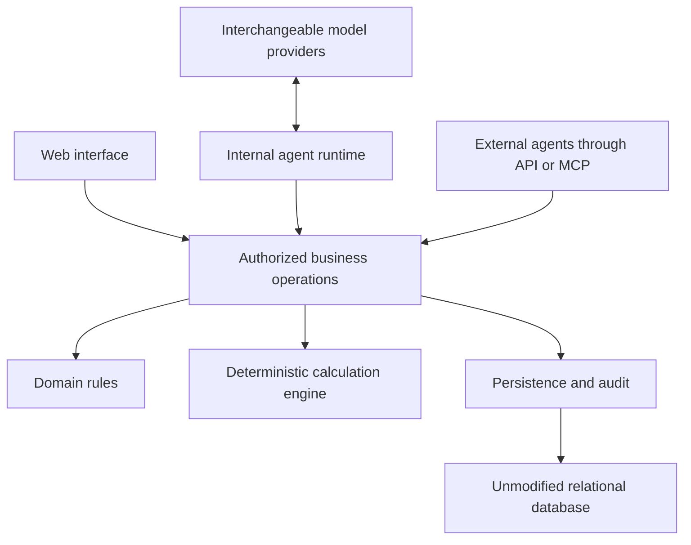

# Architecture and domain contracts

Status: baseline approved for implementation and publication on 2026-10-16.
No implementation is implied by this document.
See [decisions](decisions.md) for the distinction between agreed requirements,
proposals and choices that still need evidence. See [the delivery plan](plan.md)
for implementation scope and exit criteria.

## 1. Product purpose

Build an ETRM that an AI can use as a complete application. People, internal
agents and external agents operate through the same business capabilities.
Conversational interfaces, models and providers can change without changing the
meaning of a booking, market input, calculation or authorization decision.

Most behavior is deterministic application code: identity resolution, contract
validation, schedules, units, arithmetic, pricing, risk, permissions and durable
workflows. A language model interprets intent, proposes structured actions and
explains retained evidence. It does not become the authority for these rules.

The initial product scope includes futures and fixed/floating linear products.
Futures require explicit settlement/variation-margin state and outstanding risk,
not only an ordinary forward formula. The contracts must accommodate
future option pricers, physical operations, optimization and complex fees without
replacing the scenario mechanism or collapsing the side architecture.

The application must be self-hostable from public dependencies. Its foundation is
an unmodified relational database, not a database fork or a private platform SDK.
The intended eventual hosted domain is leanetrm.com; deployment is a later,
separately approved operational step.

## 2. Application structure and deployment

Start with a modular monolith and three tiers: browser, application and database.
Initially there are two server components to operate: the application and the
database. The application serves the built browser assets and business API.



Logical modules:

| Module | Responsibility |
| --- | --- |
| Identity and administration | Principals, scopes, grants, policy, provider configuration and audit |
| Reference data | Business definitions: units, currencies, commodities, typed locations, calendars, venues and product/index identities |
| Market setup | Versioned pricing, quantity, delivery, settlement and rounding configuration |
| Instruments | Sides, compositions, templates and instrument memberships |
| Trading | Portfolios, books, trades, instrument quantities, amendments and lifecycle |
| Market data | Primitive factors, observations, curve definitions and snapshots |
| Calculation | Schedules, pricer execution, scenarios, risk and calculation receipts |
| Agent operations | Discoverable tools, task execution, provider adapters and execution limits |
| Presentation | Browser screens, reports and export views over the business operations |

Presentation uses familiar business names. Market data provides futures and
forward curves with commodity-first or market-type-first browsing. A compact
market date/time selector sits in the header; user profiles hold time zone and
other remembered display preferences. Minutes are enough for ordinary display;
exact retained instants and selected versions remain unchanged underneath. Repeated
local clock times must remain distinguishable, for example by showing an offset
only when needed. Internal GUIDs, database fields and numerical implementation
labels are not user-visible column names or calculation receipts.

Navigation and curve-list side panels and their menu groups can collapse as
remembered user layout choices. Ordinary tables support display-only search and
column filters with visible row counts. Connected pricing worksheets keep their
complete contract mappings. Filtering never changes calculation inputs or access;
filter state is discarded when its authorized data/context scope changes.

Profile customization is presentation state, never a source of authorization,
market-input selection policy or contractual clock conventions. The local preview
stores versioned preferences per demo persona in the browser; verified account
profiles and synchronization across devices remain part of identity integration.

Modules have explicit contracts. The domain and numerical core do not depend on
web frameworks, persistence libraries, model-provider SDKs or browser state.

The approved implementation stack is a TypeScript browser client, a C#/.NET
application service and standard PostgreSQL. Exact dependency versions are chosen
and pinned during setup. A separate native calculation service is not required
for the first slice. A measured bottleneck can justify moving an implementation
behind the existing calculation contract later.

Add a table, configuration value or dependency only with a named current consumer
or a concrete executable baseline use case. A seed row or a viewer alone is not
sufficient. The current units and interest conventions are small project-owned
implementations with explicit versions and independent numerical tests. Additional
algorithms or dependencies require a concrete consumer and qualification; their
availability does not justify unused catalogs or inherited defaults. Numerical
policies remain explicit without changing exact monetary arithmetic. Broader
calendar/FX work stays in the plan until its workflow is implemented.

Long computations use durable jobs. A worker can eventually be deployed
separately without changing permissions, inputs or result contracts. Separate
services are introduced for measured operational needs, not as a prerequisite to
modular code.

## 3. Domain vocabulary and ownership

The contractual hierarchy is:

```text
Portfolio
  Books[]
    Book
      Trades[]
        Trade
          Instruments: immutable instrument references with signed quantities/bases
          Lifecycle state and retained events

Instrument
  Side memberships[]: side reference, coefficient, role and order
    Side definition
      Optional ordered composition members
      Schedule definitions and generated dated legs
```

These are distinct concepts:

- A portfolio contains books; a book contains trades.
- A trade directly owns its instrument-to-quantity bindings and lifecycle state.
  It may contain more than one instrument, each with its own quantity/unit/basis.
  No separate quantity-bearing domain class sits between trade and instrument.
  Stable binding/obligation keys retained inside Trade can distinguish different
  occurrences of the same definition; equivalence alone does not merge them.
- A side is an independent reusable definition, not a booked trade.
- An instrument contains one or more sides. A single-side instrument still
  retains an instrument identity and explicit membership.
- Coefficients and ordering belong to instrument memberships. They do not make a
  new side definition merely because another instrument uses different weights.
- Signed booked quantities belong to the trade's instrument bindings, with an
  explicit unit and basis for each instrument.
- Generated schedule legs are dated delivery, observation or payment events. A
  generated leg is not another side.
- A composite side contains explicit members, coefficients, roles and ordering.
  Dependencies between components, including quantity sources, are explicit.

Each side may have its own commodity, location, unit, currency, index, delivery
shape, observation convention, payment convention and calendar. An instrument
does not impose a shared location or schedule on all its sides.

Physical activity and its financial payments remain distinguishable. Reusing a
physical quantity as a payment basis must not count that quantity or cashflow
twice. Operating constraints must not be disguised as linear financial sides.

For example, one trade can directly bind an option instrument to its contract
quantity and a cash instrument to a premium payment quantity. The trade coordinates
booking and lifecycle across those bindings. An instrument's membership role or a
trade's descriptive payment role does not apply an extra pay/receive sign.

`Trade.PV(context)` aggregates the values of its instruments at their respective
quantities and lifecycle states. Each instrument retains its common behavior
contract and delegates to its sides. Currency conversion remains explicit.

The local preview now implements shared certified contexts for existing market,
rate, reference and schedule screens, plus current workspace administration.
[Implementation scope](implementation.md#shared-historical-market-view-and-administration)
records the qualified boundaries; the trading abstractions here remain design.

### 3.1 Definition identity and versions

Use **economic equivalence** to describe reuse: instrument definitions with the
same canonical economic terms and supported conventions can be shared across
trades within an authorized namespace. Instrument identity includes its economic
type, side definitions, membership coefficients, relevant ordering and quantity
transformations. A trade's quantity, booking identity and lifecycle state do not
create different reusable instrument terms. Equivalence for definition/calculation
reuse does not imply that separate booked trades or their obligations are merged.

Canonical side identity includes applicable economic terms, normalized numeric
values, exact typed reference bindings and schedule conventions. For future
options this includes strike, right, expiry, exercise and settlement terms.
Different strikes are different definitions. Identical complete definitions may
be reusable within an authorized identity namespace.

Labels, instrument membership weights, booked quantities, current market prices
and valuation outputs are excluded from side identity. Canonicalization itself
has a version and must preserve economically meaningful ordering and distinctions
between missing, explicit zero and explicit references.

Do not infer equivalence from a display name. A content hash is an identity aid,
not a permission grant or a reason to disclose another workspace's definitions.
Uniqueness and conflict handling must be enforced atomically, not only by the UI.

Definition changes produce retained versions. Editing one instrument's use of a
shared side creates or reuses the appropriate new definition and changes only the
selected binding. Other instruments and prior runs retain their bindings.

### 3.2 Schedules and quantity bases

Schedule definitions retain delivery intervals, observation rules, payment rules,
calendars, time zones and source versions. Generated events retain their source
definition and trade/instrument/membership context.

Distinguish total-period quantity, flow rate and quantity per occurrence. A total
quantity must not be multiplied by schedule hours a second time. A flow rate must
be integrated over the actual supported intervals. Date-only values remain dates;
instants retain offsets/UTC identity and the relevant time-zone rules.

Actual instants persist in UTC and render in the user's selected display zone.
TOU definitions retain local recurring rules and explicit versioned market clocks,
including fixed-offset and DST-following conventions. Compile them to UTC delivery
intervals; never let a display preference change contractual operating dates,
TOU membership or delivered energy. Source feeds can use a different clock from
the contract. See [time-and-schedules.md](time-and-schedules.md) for clock types,
mixed-clock predicates, DST policies, provenance and qualification gates.

Normalized shapes used for quantity reuse are part of the reusable contract. Two
equal total quantities with different hourly profiles are not equivalent inputs.

Separate named schedule definitions can share identical immutable typed date
payloads. Definitions retain semantic roles, source versions, coverage and
occurrence mappings; equal dates do not merge booked obligations or establish PV
reuse. A small compiled temporal kernel can compose holiday/date sets, ordered
events and interval/TOU selections while preserving their distinct semantics.
Joint-calendar policy, adjustment order, grid resolution and clock/DST rules are
explicit. Canonical publication is atomic; pricing reuses validated in-memory
artifacts. Proposed representations and performance qualification are in
[the schedule design](schedules-and-contract-sequences.md#shared-immutable-data-composition-and-the-fast-path).
No implementation speed claim follows from this design alone.

### 3.3 Behavioral contracts on instruments and sides

Every instrument exposes a common behavior contract. Every side owns the behavior
for generating its schedule and computing its contribution to PV from that
schedule. These are executable domain abstractions, not only data records.

The proposed minimal interfaces are:

```text
Instrument
  GenerateSchedule(scheduleContext) -> SchedulePlan
  PV(valuationContext) -> ValuationResult
  Dependencies(resolutionContext) -> DependencySet
  Validate(resolutionContext) -> ValidationResult

Side
  GenerateSchedule(sideScheduleContext) -> SchedulePlan
  PV(sideValuationContext) -> ValuationResult
  Dependencies(sideResolutionContext) -> DependencySet
  Validate(sideResolutionContext) -> ValidationResult
```

Use interfaces and abstract base classes to require the behavior. Provide shared
base implementations where semantics agree: an ordinary instrument combines side
event plans and sums normalized, signed side contributions; leaf sides implement
their own schedule and PV behavior. A composite side delegates to its components.
Different instrument business labels do not require different subclasses unless
their behavior differs. Avoid a deep inheritance tree for combinations of terms.

All evaluation receives an explicit pinned context, even if the public operation
is informally called `PV()`. The context supplies resolved definitions, schedules,
market/scenario inputs, numerical policy and approved model bindings. It does not
expose an unrestricted database or mutable application state.

A side can delegate numerical work to a registered pricing strategy. Contractual
terms and model selection remain distinct, so comparing two approved models does
not require changing the contract. The scenario engine invokes the common
valuation contract without knowing the side's internal algorithm.

Persist versioned definitions and type identifiers through explicit schemas,
rather than serializing arbitrary runtime objects. Deriving a class does not
permit loading tenant-provided executable code. Cache resolved schedules where
their complete inputs agree instead of regenerating them for every `PV()` call.

### 3.4 Explicit sibling-side references

An instrument may have sibling sides in this form:

```text
Instrument
  [0] OptionSide: references [1] and [2]
  [1] FloatingFinancialSide
  [2] FixedFinancialSide
```

The array indexes illustrate the relationship; persist stable typed references or
semantic slots resolved to versioned memberships, never mutable array positions.
An option side need not own or wrap the other sides structurally. It can consume
their schedules, terms and permitted valuation inputs through its side context.

Declare those references so validation, dependency propagation, authorization and
calculation identity can see them. Resolve reusable slot-based definitions in the
selected instrument context. Resolved sibling versions, membership coefficients
and relevant quantity transformations are part of that calculation's identity;
the same side definition in a different sibling context is not automatically the
same calculation.

References are directed. Validate their ordering and reject dependency cycles,
including a side that calls the total instrument PV while that total is waiting
for its own PV. Reading a peer's independent base schedule/value is distinct from
recursively asking for a value already controlled by the requesting side.

Expose peer base valuation and final contributed valuation through distinct typed
evaluation modes or separate context operations. Do not make a generic `PV()`
silently mean one or the other depending on call order. The resolved execution
plan specifies which value a dependency consumes.

For options, sibling visibility alone does not define exercise or PV accounting.
The future option contract in section 5.4 must distinguish additional obligations
from exercise control of existing obligations before that product is enabled.

### 3.5 Physical and financial composition

A composite side can combine a physical delivery side and a financial side to
represent a physical swap. Keep each component's schedule and valuation behavior:

```text
CompositeSide
  PhysicalSide: delivery events and commodity-specific delivery terms
  FloatingFinancialSide: payments linked to the declared delivery quantity
```

Gas physical terms can include pipeline, zone, receipt/delivery point and gas-day
conventions. Power physical terms can include market, node/zone, delivery profile
and the applicable clock. These are typed commodity-specific references and
conventions, not one unvalidated location string.

The financial component explicitly binds the physical quantity/activity that it
prices. Components declare whether their PV represents delivery's economic value,
cash payments, fees or another supported obligation. Count commodity value once
and keep it distinguishable from contractual payments. A physical movement does
not silently imply an additional cash sale.

Combine schedules by retaining event identity, type, source side/component and
quantity/payment links. An instrument schedule is an aligned view of these events,
not a date-only join that duplicates payments or forces all event types to have
the same frequency. Valuation still delegates to the side implementations.

## 4. Market factors and curve dependencies

Curves own common constituent specifications, with dated market contracts retaining
their identities and dated terms. Commodity, yield and composite/algorithmic curves
have explicitly typed specifications. Versioned source bindings and delivery
mappings support multiple dependency layers, including forwards consuming futures.
Pricing construction and contractual settlement remain separate. Source expiry
requires an explicit frozen-final/transition/end-eligibility rule; never silently
roll or replace missing inputs. See the agreed domain structure and five-layer
example in [market-model.md](market-model.md). Detailed internal storage records
there are proposals, not additional required public business classes.

Business references and market setup are distinct concepts even where their
versioned storage shares a reference catalog. Internal joins, provenance and
version machinery are not separate user-maintained business catalogs. Financial
configuration still requires exact version pins and authorized changes.

Locations have explicit types such as pipeline, node, hub, region, terminal and
delivery point. Type and geography are independent: a point, route, area or
membership set must be supplied according to its supported convention. Optional
WGS 84 latitude/longitude point fields are implemented; route/area geometry and
topology remain future scope. Never invent a point for unknown or non-point
locations or infer pricing dependencies from geographic proximity.

Reference data includes relational currencies, units/dimensions, commodities,
typed locations, exchanges, clearing houses, clocks/calendars, rate conventions,
and futures product/series definitions. Use exact catalog/revision foreign keys
for these relationships; no free-text or arbitrary JSON reference substitutes.
See [reference-data.md](reference-data.md) for futures accuracy, public placeholders,
settlement semantics, provenance and the initial immutable revision schema.

A primitive risk factor is an independently shockable market input. Its identity
includes the market definition, actual dated contract or delivery bucket, quote
kind and units. Observations retain source, observation time, availability
provenance and revision. An outright price and a basis spread are different
factors.

Names such as `prompt` are aliases. Resolve them to actual dated contract IDs when
creating a run. Retain the resolved mapping so a later roll cannot rewrite a run.

The agreed current-contract rule advances through its retained contract sequence
at recorded expiry. Newly listed far-end contracts extend that sequence
independently. A relative ordinal requires explicit coverage and eligibility;
missing data does not authorize skipping the expected next entry. Reusable
schedules may be supplied as retained rows or materialized by a named deterministic
definition with explicit parameters. People and agents share the same authorized
maintenance operations; calculations consume pinned rows and rule versions.
Business-day calendars, contract milestones and generated schedules retain their
distinct roles. See [schedules and contract sequences](schedules-and-contract-sequences.md)
for the proposed minimal resolver and qualification gates. This is not yet an
implemented alias or general schedule generator.

Curves are versioned recipes over factors, constants, reference data and other
curves. Dependencies include delivery mappings, interpolation, calendars,
currency/FX, discounting and fixings where consumed. Dependency on a curve name
alone is not a complete declaration.

An illustrative synthetic recipe is:

```text
LocationGas(month) = BaseGas(month) + GasBasis(month)
HubPower(interval) = HeatRate(interval) * LocationGas(GasMonth(interval))
                     + PowerSpread(interval)
LocationPower(interval) = HubPower(interval) + PowerBasis(interval)
```

`GasMonth` is an explicit mapping. `HeatRate` has units of thermal energy per
electrical energy; prices and spreads must have compatible currency and units.
The gas, power spread and locational basis inputs remain independently shockable.

With a fixed heat rate of 7 MMBtu/MWh, an absolute gas shock of 0.10 USD/MMBtu
changes the dependent power price by 0.70 USD/MWh. A trade holding a receive-floating quantity of
10,000 MWh has scenario P&L of 7,000 USD before discounting, holding all other inputs fixed.
This is a synthetic arithmetic acceptance case, not a claim about market pricing.

A power curve inherits gas exposure only when its approved recipe specifies that
relationship. Historical correlation alone does not define a pricing dependency.

An explicitly selected all-in mark is a direct price input without inferred
upstream curve dependencies. Base exposure requires an explicit base-plus-spread
definition and a spread mark. Never infer an implied spread from an all-in mark,
silently switch pricing modes or allocate exposure from price/spread proportions.
Other declared inputs consumed by an instrument/pricer remain applicable.

**NEVER ASSUME user intent. NEVER SILENTLY GO TO DEFAULTS.** Missing, ambiguous or
conflicting financial behavior raises a structured error. Policies and applied
choices must be explicit and retained in the resolved context. See
[market-data.md](market-data.md) for mark modes, dated contract histories, future
historical alignment and deterministic repricing acceptance.
The local [market-model proposal](market-model.md) details entity/version keys,
typed reference links, quote/quantity specifications and snapshot input roles.
Its broader shapes remain a design proposal. The implemented commodity/series
subset and current security/RLS boundary are described in
[implementation.md](implementation.md) and [security.md](security.md).

### 4.1 Storage and execution

Persist recipes and dependency edges in ordinary relational tables with typed
references and versioned schemas. Compile them into an in-memory directed
acyclic execution plan. A graph database or generic property-graph platform is not
required.

Reject cycles, missing dependencies, incompatible units, unsupported operators
and ambiguous mappings before activation. Evaluate a shared derived node once
per scenario. Retain an index from inputs to dependent computations to identify
affected work. The persisted declarations and compiled plan must agree.

A future calibration or optimization operation that solves a coupled system can
be one versioned computation with explicit external inputs and outputs. It must
not introduce an uncontrolled cycle into the execution scheduler.

Distinguish a shock to an input quote, followed by rebuilding/recalibration, from
a direct shock to an already-built output curve. These are different scenario
definitions. Do not shock a derived value and its primitive source accidentally
or count inherited risk twice.

## 5. Shared scenarios and black-box pricers

The fundamental operation is **shock market factors, then compute the affected
valuations against the same scenario**. Never implement market shocks as
individual mutations of trades or live quotes.

A run pins:

- Base market observations, selected revisions and availability context.
- Actual factor identities and alias/delivery mappings.
- Curve recipes, reference data, calendars and schedule versions.
- Trade, instrument, membership and lifecycle versions.
- Valuation date/time, output currency and explicit FX/discount conventions.
- Pricer/model/operator versions and numerical policy.
- Scenario definitions, including bump sizes, units and rebuild policy.
- Initiating principal, authorization scope and request identity.

The execution sequence is:

1. Authorize the request and resolve a complete immutable input manifest.
2. Validate the request, model capabilities, units and dependency plan.
3. Construct the base scenario and sparse up/down overlays on primitive factors.
4. Rebuild affected dependent values in dependency order under each scenario.
5. Invoke each affected unique valuation computation against those values.
6. Apply eligible instrument quantities held by trades and membership coefficients.
7. Aggregate by authorized book/portfolio/currency and persist a result receipt.
8. Recheck current access before returning or exporting results.

Pricers are black boxes to the risk engine. A linear formula, option pricer or
optimization algorithm implements the same evaluation boundary. Each declares
its input dependencies, output schema, units, version and supported quantity
behavior. Dependencies may be conservative; they must never omit an input that
can affect the result. Dynamic market requests must stay within an explicit,
versioned input manifest rather than escape dependency tracking.

Pricers receive explicit inputs through a market context and have no hidden
network access, database access, wall clock or mutable global market state.
Missing inputs, nonconvergence and invalid contracts are structured failures.
An unavailable result is not zero exposure. Unrelated successes may be retained,
but a partial run is visibly partial and cannot be represented as a complete
portfolio result.

The initial engine supports trusted built-in operators. An extension interface
does not authorize tenants or agents to load arbitrary executable code.

### 5.1 Factor application versus valuation reuse

Apply a factor shock once per scenario, independent of how many computations
consume it. This does not imply that every different pricer can share one
valuation result. Reuse results only for identical eligible valuation inputs.

Different shapes, strikes or calendars do not require separately applying the
market shock. They may require different valuation computations against that
same shocked market. This separation is essential.

Zero observed delta does not mean that a computation lacks a dependency. A future
option or optimizer may respond only to larger or one-sided changes.

### 5.2 Quantity scaling

Keep three concepts separate:

| Property | Meaning |
| --- | --- |
| Dependency | A factor or derived input can affect a computation |
| Market linearity | Value responds linearly to a specified market input under specified assumptions |
| Quantity scalability | Changing a trade's instrument quantity scales value without changing the unit computation |

For an eligible composition:

```text
InstrumentUnitValue(instrument, scenario) =
    sum(MembershipCoefficient * UnitSideValue(scenario))

TradeValue(scenario) = sum over Trade's bindings of
    Quantity(binding) * InstrumentUnitValue(binding.instrument,
                                            binding.lifecycleContext, scenario)
```

The normalized shape, contractual terms and valuation context belong to the unit
calculation. Quantity is factored out only when the pricer's contract guarantees
this relationship for the requested quantity basis and domain. Validate this
property with tests; do not infer it from a product label.

For each instrument, every `UnitSideValue` is expressed per the same instrument
quantity basis and in the same output currency. Sides may retain different native
units and currencies; explicit versioned per-side quantity transformations and,
where supported, pinned FX conversion normalize their contributions before the
sum. Reject a composition when those transformations are missing or unsupported.
A dimensionless membership coefficient cannot substitute for an undeclared unit
conversion, heat rate, delivery shape or contract-lot multiplier.

The baseline uses a positive-receipt orientation for unit side values. A signed
membership coefficient defines the side's contribution and the trade's signed
quantity for that instrument defines its direction. The membership role is descriptive and
does not apply another sign. Nested composition coefficients obey the same rule;
do not apply pay/receive direction again from a label or side kind.

The baseline enables quantity scaling for supported linear products. Future
nonlinear market payoffs may also be quantity scalable: a holding of identical
ordinary options can scale by contract count even though its market response is
nonlinear. This does not make options at different strikes equivalent.

Minimum fees, quantity tiers, capacity constraints, market impact and other
size-dependent rules can invalidate simple scaling. Fixed cash amounts are
separate components. Do not force them into a unit multiplier or silently reuse a
result outside its declared domain.

### 5.3 Sensitivities, scenario P&L and explain

Finite differences and full repricing are the generic black-box mechanism. For
an absolute bump `h` in factor `f`:

```text
Delta_f = (V(f+h) - V(f-h)) / (2*h)
Gamma_ff = (V(f+h) - 2*V(f) + V(f-h)) / (h*h)
UpScenarioPnL = V(f+h) - V(f)
DownScenarioPnL = V(f-h) - V(f)
```

These PV evaluations are deterministic: identical pinned inputs, scenario, model
versions and numerical policy yield identical results. Dependency traversal
identifies affected work; it does not assign exposure amounts. Risk is measured
from the instrument/pricer outputs, not allocated from spread levels or inferred
hedge relationships.

Retain bump size, absolute/relative convention, factor units, output currency,
derivative units and whether quantities are applied. A derivative and a finite
shock P&L are different artifacts. A percentage bump near zero needs an explicit
definition; it must not be silently substituted for an absolute bump.

Analytic derivatives, automatic differentiation and sparse linear exposure maps
can be optional accelerators. The engine must not require them to understand a
pricer's internals. Validate accelerators against the generic repricing path.

Multiple-factor explain may require cross terms. A meaningful period P&L explain
also separates market movements, carry/time, fixings, rolls, FX translation,
bookings/amendments, model/reference changes and rounding. Define the ordering
and attribution convention so components are not counted twice. Always retain
full-revaluation P&L and the explain residual.

Nonsmooth payoffs and optimization decisions may not have stable local Greeks.
Retain the actual scenario results and diagnostics rather than claiming that a
Greek approximation is exact for every future model.

### 5.4 Future option sides with sibling visibility

This is a proposed extension boundary, not an implemented option product or a
settled accounting choice. Preserve the sibling topology in section 3.4.

An option side retains explicit target-side bindings, payoff/strike terms,
exercise opportunities, settlement rules and model requirements. Its event plan
includes contingent obligations and their exercise group. It can consume the
target sides' schedules without turning those obligations into a duplicate set
of active instrument cashflows.

Distinguish at least two meanings:

- An additional option payoff over sibling observables, while the siblings remain
  independent contractual obligations. The side contributes that extra payoff's
  PV, and the instrument sums all contributions.
- An exercise right controlling whether/how selected sibling obligations occur.
  Value the controlled group jointly; do not add a full option-on-group PV on top
  of the same underlying group's unconditional PV.

One proposed representation for the second meaning is an adjustment contribution:

```text
OptionContribution = PV(group with exercise rights)
                     - PV(the same unconditional target group)

InstrumentPV = sum(target-side base contributions) + OptionContribution
               + sum(other independent contributions)
```

Both group valuations use the same resolved weights, quantity basis, market
context, currency and model conventions. In this representation the target-side
base contributions are valuation attribution components; their event plans still
show the actual contractual exercise contingency. They must not be presented as
unconditional deliveries/payments merely because the attribution uses a base PV.

A joint group evaluator with an explicit allocation back to side contributions is
another possible representation. Settle and test this choice before enabling
options. Do not combine overlapping control groups by summing independent
adjustments unless that decomposition is proven valid.

The contract must also define the option membership's own coefficient and the
fraction/quantity of target obligations it controls. A coefficient on an
adjustment is not permission to silently scale the controlled group a second
time. This mapping belongs in the resolved valuation identity and tests.

Shared versus independent exercise is a contractual distinction. An option over
one net group differs from separate options on each component. Its pre-exercise
PV uses a suitable model of future outcomes, not a maximum applied to today's
aggregate PV. Automatic market shocks still operate on primitive inputs and all
affected pricers consume the same scenario, including volatility/correlation
inputs where required by a supported model.

## 6. Numerical values, units and rounding

Build a numerical foundation broader than a `Money` wrapper:

| Concept | Example |
| --- | --- |
| Money | USD |
| Price | USD/MMBtu |
| Quantity | MMBtu or MWh |
| Flow rate | MW |
| Conversion factor | MMBtu/MWh |
| Dimensionless value | Membership coefficient or discount factor |

Typed arithmetic must support multiplication, division and compatible addition:

```text
(USD/MMBtu) * MMBtu = USD
MW * elapsed_hours = MWh
(USD/MMBtu) * (MMBtu/MWh) = USD/MWh
```

Currency is part of the type. Adding different currencies requires an explicit,
dated FX input. Unit conversions require a retained definition and convention.
Similar names do not prove compatibility. Temperature/pressure or energy-content
assumptions cannot be invented when converting physical quantities.

Separate:

1. Accepted input precision and retained source values.
2. Working precision and guard digits for each supported algorithm.
3. Contractual cashflow/settlement rounding, including where it occurs.
4. Aggregation and reporting rounding.
5. Display formatting.

Use bounded, deterministic arithmetic with explicit overflow, division, rounding
and nonfinite-value rules. Reject unsupported inputs instead of silently
truncating them. Avoid unlimited precision growth, early currency rounding and
implicit conversion through browser binary numbers. Decimal financial values
cross the API as canonical strings.

The working representation and precision budget are implementation decisions
requiring correctness and benchmark evidence. Evaluate a standard bounded
decimal implementation before writing a custom number engine. Any future
floating-point solver is an explicit numerical mode with tolerances and a
retained version; it cannot silently replace financial decimal arithmetic.

Finite differences require cancellation and bump-size checks against the working
precision. Persist the numerical policy with results. Unit conversion and
rounding must agree across input, engine, storage and exports. Database columns
must not silently coerce values to a lower scale than the contract permits.

Define a deterministic accumulation/reduction policy, including working
precision, contribution ordering and overflow behavior. Parallel workers must
not change that policy through completion order or arbitrary partial sums. Test
different input enumeration, worker counts and scheduling against the same
canonical result. The selected reduction policy is part of the numerical version.

Quantity scaling and netting must preserve contractual rounding boundaries.
Rounding individual settlements and rounding an aggregate are not generally
equivalent. Distinguish economic unrounded risk from booked/rounded amounts and
reconcile the two explicitly.

## 7. Persistence, revisions and historical replay

Use relational tables for domain identities, immutable definitions/versions,
memberships, effective intervals, market observations, grants, jobs and audit.
Foreign keys, uniqueness constraints and transaction boundaries enforce the
same invariants for UI, agents and imports. Versioned structured payloads may
hold operator-specific terms; they do not replace typed business relationships.

Every mutation creates an application revision within its workspace and records
the affected versions atomically. Concurrent writers use explicit expected
versions and serialization for revision allocation. A rollback cannot publish a
revision or partial booking. The baseline does not promise atomic cross-workspace
business mutations.

Retain both contractual effective-time information and the application revision
at which information became known. A backdated correction does not rewrite a
previously captured input manifest. Historical calculation inputs are pinned
through all lazy/paged reads.

The baseline requires a bitemporal historical environment: business/effective
time and a knowledge cutoff. A user can select a past context and see trades,
market information and all their dependencies under that same selection. The
server resolves the requested coordinates into an immutable context used by UI,
API, agents, schedules, PV/risk, background jobs and exports.

Use `effective_from` / `effective_to` and `known_from` / `known_to` for retained
half-open intervals. Context point selectors are `effective_at` and `known_at`.
Knowledge endpoints have UTC timestamp precision; reserved finite open ends and
boundary predicates follow the shared context contract. Contract delivery/start
attributes are separate fields, not historical interval endpoints.

Committed application revisions provide the authoritative knowledge ordering.
Mapping a user-selected date/time to those revisions is a required baseline
capability, with an explicitly tested publication/commit-visibility contract.
A row timestamp assigned before commit is not a permanent database commit
timestamp. Do not claim physical commit-time semantics from an ordinary timestamp
column or allow later imports/corrections to leak into earlier knowledge.

See [Historical context and temporal data](context.md) for coordinates, retention,
market-observation rules, UI switching, date resolution and qualification gates.
The resolver implementation is an open decision; the product requirement is not.

Saved calculations retain immutable input manifests, result schemas and operator
versions. Historical replay either uses the retained implementation or reports
that exact replay is unavailable. Revaluation under a newer model is a separately
identified result, never a rewrite of the old receipt.

Historical data selection does not restore old permissions. Access is checked
under current policy. Retention/deletion rules, including retained execution
artifacts, must be explicit rather than assumed from versioning.

### 7.1 Business events and lifecycle

Instruments and sides define supported lifecycle behavior; the booked trade
owns the resulting state for its instrument bindings and obligation occurrences. A reusable side or instrument
definition does not acquire a global exercised/expired/cancelled status because
one trade changes.

The proposed command, event, transition and scheduling contracts are detailed in
[Events and lifecycle](lifecycle.md). Keep scheduled obligations distinct from
committed facts, preserve amendments as retained transitions and serialize
automated lifecycle processing with manual commands. Lifecycle inputs and state
versions are part of schedules, valuation manifests and result identities.

## 8. Performance and result reuse

Optimize duplicate work and data movement before distributing services:

- Load a complete consistent authorized input manifest in bounded batches.
- Compile curve and schedule definitions once for a compatible context.
- Evaluate shared dependency nodes once per scenario.
- Use dependency indexes to skip provably unrelated computations.
- Reuse identical eligible unit valuations across memberships and trades.
- Apply quantity scaling and aggregate in batches.
- Parallelize independent work with bounded resource use.
- Keep database calls and provider calls outside pricing inner loops.

A cache key includes the pricer and schema version, normalized contractual terms,
normalized schedule, relevant dependency content/versions, valuation context,
scenario definition and numerical policy. It includes quantity where scaling is
not valid. Cache identity must not depend on a mutable alias alone.

Begin with safe within-run reuse. Cross-run reuse is introduced only after
dependency completeness, invalidation and authorization are demonstrated.
Prefer explicit version/content identities to guessing what might have changed.

Caches are calculation artifacts, not access grants. A cache hit cannot disclose
hidden definitions, private observations, book membership or inferred existence.
Sharing immutable computational storage across scopes requires an independent
security design; the initial cache boundary is the authorized workspace.

Publish measurements for unique contracts, trades/instrument bindings, affected dependency nodes,
scenarios, actual pricer calls, database reads, cold/warm execution, latency,
throughput and memory. A workload with many copies of one contract is different
from one with the same number of unique contracts. No throughput claim precedes
a reproducible benchmark.

## 9. Administration and authorization

Administration is part of the core application, not a late collection of screens.

| Control | Contract |
| --- | --- |
| Principals | Individually identifiable humans, agents and service accounts; active/disabled state and credential lifecycle |
| Scopes | Company/workspace and applicable desk, book, portfolio and record scope |
| Capabilities | Separate read, compose, book, amend, calculate, publish market data, export and administer actions |
| Delegation | An agent receives explicit bounded authority; acting for a user cannot exceed that user's effective authority |
| Policy | Versioned grants, limits, approvals and separation of duties |
| Providers | Allowed destinations/models, credential custody, data routing and budgets |
| Operations | Agent pause, queued-job cancellation, run inspection and recovery |
| Audit | Identity, authority, request, approval, affected versions and outcome |

Authentication and authorization are distinct. Credentials authenticate an
identity; they do not let the caller supply trusted scope, capability or approval
claims in an arbitrary payload. All entry points invoke server-side policy.

Delegation includes an expiry, revocable identity, allowed actions and resource
scope. Effective authority is the intersection of the caller, any represented
user and the delegation policy. Redelegation is disabled unless explicitly
permitted and can never expand scope or extend the originating authority's
lifetime. Recheck the relevant authority chain at execution.

Administrative roles do not implicitly grant business-data access. Elevation is
explicit, authorized and audited. Policy may require another identity for
sensitive permission changes, large bookings, market publication or settlement
actions. Routine authorized work need not prompt for approval on every tool call.

Approve the exact normalized payload, scope and expected versions, with expiry
and an approver identity. Changes after approval require renewed validation and,
where policy requires it, a new approval. A model cannot approve its own proposed
action by generating text that claims approval.

At execution, verify that the approver is still active and authorized for that
approval. Consume a single-use approval atomically with its authorized effects
and request outcome. Reconciliation of the same request returns the retained
outcome; a different request identity cannot reuse the approval to repeat the
effect. Any reusable approval must instead be an explicit bounded policy with
its own scope, limits and consumption rules.

Separate migration/ownership credentials from the application role. The runtime
role has no superuser or row-security bypass capability. Use row security as an
additional boundary where appropriate, with explicit tests of owner/bypass roles,
connection-pool context cleanup and every background execution path.

Define revocation at an explicit authorization boundary. A completed revoke must
block subsequently admitted operations. Long calculations recheck current
authority before publishing/returning data. Queued jobs do not retain revoked
authority. Already delivered data cannot be retracted. Permission checks must not
read historical grants merely because business inputs use a historical snapshot.
Implementation must address transaction snapshots and revoke/restore epochs.

Authorization and mutation/result-publication decisions must serialize with
revocation. A permission check followed by an unprotected later commit is
insufficient. Use a transactional authorization fence, epoch proof with protected
commit validation, or an equivalently tested mechanism. A proof invalidated by a
completed revoke cannot subsequently commit new effects or publish new results.

Initial provisioning is an explicit trusted operation. There are no published
default administrator passwords or production authentication fallbacks. Identity
federation/MFA and credential recovery require a separately tested integration.

Audit access is itself authorized. Protect audit integrity from ordinary users;
record exports and administrative changes. Retain public action explanations and
tool evidence as appropriate, not secrets or private model reasoning. Define
retention and redaction policies for prompts, tool payloads and provider logs.

## 10. AI and external-agent interfaces

Each business operation defines a versioned identifier, description, input/output
schema, required capability, scope, temporal context, validation behavior,
side-effect class, idempotency behavior and audit result. Input bounds and paging
limits are part of the contract.

Agents must be able to discover capabilities and schemas, resolve identifiers,
inspect current state, propose changes, preview calculations, execute authorized
actions and reconcile an uncertain result. A chat-only workflow or a UI-only
business action is incomplete.

HTTP and MCP are adapters over the same operations. Discoverability does not
replace enforcement: knowing a tool name does not authorize using it. External
agents authenticate independently and receive scoped grants. They receive no
database credentials or unrestricted SQL tool.

The model-provider boundary normalizes messages, structured tool requests,
streaming, cancellation, usage and error categories. Provider-specific SDK types
and response IDs remain outside domain contracts. Capability negotiation handles
models with different tool/schema/context support explicitly; provider independence
does not promise equal model quality.

Routing is constrained by administration policy. Do not silently send data to a
different provider after an error. Bound steps, tokens/cost, elapsed time,
concurrency, retries and accessible tools. Secrets stay in protected server-side
configuration and must not enter model context or audit payloads.

Documents, market feeds, retrieved text and tool descriptions from external
sources are untrusted data. They cannot grant authority, override system policy
or authorize an outbound action. Workflow persistence records structured,
validated operations rather than relying on a prompt as an executable contract.

Evaluate agent tasks by correct business outcomes and policy compliance, not just
whether the model returned plausible prose. The deterministic business workflow
must remain usable when no language-model provider is configured.

## 11. Durable execution and failure semantics

Commands have client-supplied request identities scoped to the operation and
authorized workspace/principal. Store normalized payload identity and outcome
atomically with effects. Reusing a key for a different payload is a conflict.
Unknown transport outcomes are reconciled through request status before a caller
attempts another mutation. A timeout must not create duplicate bookings.

Request-status and idempotency lookups reauthorize the caller and use trusted
identity/scope, not caller-supplied ownership claims. A request key cannot expose
another principal's payload or outcome.

Calculations are pure over pinned inputs. Durable jobs have explicit queued,
running, completed, failed, cancellation-requested and cancelled states. Workers
use leases/fencing or an equivalent ownership mechanism. Lost ownership prevents
publishing. Persist results and terminal status atomically; expose a committed
terminal result only after its transaction succeeds.

Pure calculation work can be retried against the same manifest. External
side effects need their own idempotency/reconciliation contract. A retry does not
implicitly refresh market data, upgrade a model or restore a revoked permission.

Cancellation is cooperative and bounded where supported. A cancellation request
is not proof that running work has stopped. Resource accounting continues until
termination is confirmed. Isolation and resource limits apply to future untrusted
or expensive extensions.

Terminal transitions are atomic and exclusive. If success commits before a
cancellation request is accepted, the cancellation operation reports the already
completed outcome. If cancellation is accepted first, subsequent success
publication is rejected; confirmed termination produces the cancelled state.
Physical work may continue until it cooperates or is terminated, and its resource
usage remains visible. Test both orderings and prevent a stale worker from
overwriting either terminal outcome.

## 12. Extension boundaries

Start with typed, versioned expression operators for arithmetic, weighted
compositions, curve dependencies and fees. Pure operators declare types,
dependencies, numerical behavior, error categories and implementation versions.

Defer a general scripting engine. If one becomes necessary, require a separate
design for sandboxing, resource limits, declared dependencies, deterministic
execution, approved capabilities and version retention. No hidden clock,
network access or random source is available to a financial expression.

Future model interfaces can add volatility surfaces, exercise rules, simulation,
optimization and calibration. Reproducibility must specify seeds, tolerances,
solver/library versions and parallel execution assumptions where relevant.
Bitwise reproducibility across platforms is a separate promise requiring evidence.

The foundation is intended to endure through explicit contracts, retained versions,
replayable inputs and conformance tests. It does not attempt to implement every
future model in the first release.
