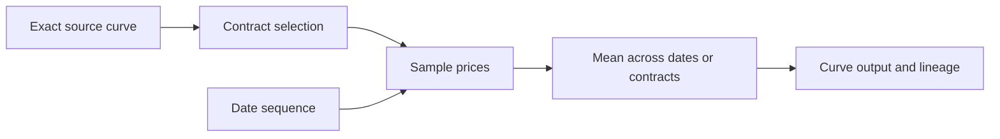

# Custom curve recipes

The local Custom curves workspace authors versioned graphs and previews their
computed values. Published versions are immutable. Visual editing and the formula
representation use the same managed validation and execution operation.
Exact source curves, calendars and published
schedule versions are retained as foreign keys. Layout coordinates have no
financial meaning.



Sources may already have the supported multi-level basis dependencies. The
recipe retrieves only its selected contracts and declares their live primitive
factors. It does not infer dependencies from quoted price levels. This workspace
does not yet make saved custom recipes bookable indices, add theoretical options,
or implement historical VaR/covariance.

The three starting recipes are:

| Recipe | Definition |
| --- | --- |
| `ng_prompt` | Position one among the retained nonexpired monthly contracts. At the exact recorded last-trading cutoff, the expired contract leaves the sequence. |
| `ng_balmo` | Arithmetic mean of one daily forward for every delivery date from the context date through current month-end, inclusive. All daily forwards are priced at the same context instant. This is distinct from a separately quoted BALMO mark. |
| `ng_average` | A mean across an explicitly selected history window for each of positions 1–12, preserving twelve output points. The starting example uses twenty prior calendar dates, excludes the context date and says so in the editor. Business-day windows require an exact calendar. |

Historical selection has two explicit meanings: resolve each relative position at
each sampling instant, or resolve today's dated contract once and sample that
same contract's history. Price retrieval never promotes a later contract when a
required mark is missing. Every selected date and contract is required; duplicate
or missing observations fail rather than changing an average's denominator.

Date windows use context, inclusive remaining-month dates, prior calendar dates,
prior business dates or an exact published schedule and occurrence range. Schedule
bindings remain references rather than copied dates. Sampling uses the exact UTC
time of day of the selected snapshot. Current inputs retain the selected snapshot's
exact observation pins; historical samples use the latest final correction visible
at the selected knowledge cutoff. These policies are explicit graph fields. The
current implementation reads history within one exact definition bundle's
applicability. Cross-revision continuous histories require a later contract.
Explicit `freeze_final_future` source edges can consume an expired future's final
settlement. Historical sampling requires a single unambiguous final event at or
after its expiry and no later than the sampling instant, with visible corrections
resolved within that event. Multiple final events reject. At the current context,
the final fixing must already be pinned in the selected snapshot.

Past samples are frozen observations. Current projected samples declare their
primitive quote factors. Scenario execution supplies changed typed input samples
and reevaluates the graph; the recipe does not fetch replacement prices inside a
calculation. Exact rational means retain the quote currency, quantity and
multiplier. Only display formatting rounds the result. Receipts include input
observations, sampling instants, actual dated contracts, output dates and live
factor declarations. Business date labels are dates; displayed instants follow
the user's time zone.

Formula mode represents those same nodes and typed edges, for example:

```text
source = source(curve="ng_monthly")
selection = select(mode="positions", first="1", count="1", binding="each_sample", source=@source)
dates = dates(mode="context", sampling="context_utc_time", corrections="exact_context_frame_history_latest_visible")
prices = sample(selection=@selection, dates=@dates)
output = output(values=@prices)
```

Parameters are quoted strings; `@name` refers to another node. This language
cannot execute scripts or SQL text. Backend formatting and compilation allow
switching between the visual graph and its formula.

Registered SQL mode supplies one qualified transformation,
`sql_mean_dates_v1`. It consumes the graph's raw sampled prices as position and
scaled-integer arrays. Its immutable query groups those supplied values and
returns an integer sum and count; managed code preserves units and lineage and
forms the exact rational output. It reads no market tables, so it cannot bypass
the supplied scenario. The catalog exposes the query, implementation version and
SHA-256. Arbitrary SQL bodies and runtime registration are not exposed. Further
transformations require a versioned input/output contract and independent
numerical, authorization and scenario checks.

Save requires current authoring permission, an exact session snapshot and an
optimistic generation. Publish requires separate publishing permission. Published
versions and their normalized graph relationships are immutable. Request replay
retains one exact command per current actor; uncertain network outcomes can retry
the original command. Full-content retry responses retain exact definition-bundle
and curve-version foreign keys and require current read access to both.
Historical views cannot author or publish, and current authority is rechecked
for source definitions and schedule/calendar references.

The As of control is a market-close calendar. Available days are qualified by the
managed backend for the selected curve, or the complete custom graph including
its history window. A date with incomplete inputs cannot be selected. Calendar
days and close times display in the user's time zone; selecting one retains the
same exact UTC snapshot and its financial business date. Multiple closes or
corrected snapshot versions on one displayed day require an explicit choice.
The calendar does not choose a substitute date or alter the separate effective
date and knowledge-cutoff controls.

Use an isolated synthetic preview with the additional monthly/daily panels:

```sh
python3 tools/run_preview.py --pg-bin /path/to/postgres/bin --dotnet /path/to/dotnet --with-custom-curves
```

The additional panel is original synthetic data, without exchange-listing claims.
The normal preview remains unchanged unless this flag is selected. Verification
uses `--custom-curves-check --browser-check --browser /path/to/chrome`; the same
check is included in `tools/check_all.py`.
